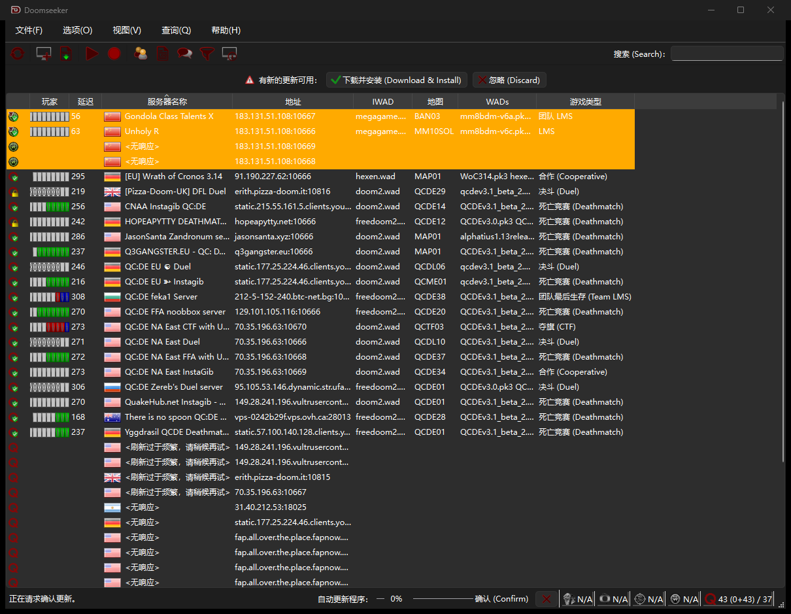

# Doomseeker 简体中文（中英双语）

[Doomseeker](https://github.com/DoomseekerTeam/Doomseeker) 1.5.3 的简体中文本地化，覆盖主程序与全部随附插件，共 **2593 条**界面文本。

> Simplified Chinese localization for Doomseeker 1.5.3. Short labels are bilingual (`中文 (English)`), long texts are Chinese-only to avoid truncation.



## 特性

- **中英双语**：按钮、菜单、标签页、复选框、短标签等显示为 `加入 (Join)`；表格列标题、长句、日志、错误等只保留中文，保证不截断。
- **完整覆盖**：主程序 1432 条 + Zandronum 631 + Zandronumq 445 + SRB2 36 + Odamex 26 + Turok 2 16 + Chocolate Doom 7。
- **格式安全**：`%1`、`%n` 等占位符、HTML 标签、首尾空白、快捷键均与原文一致。
- **已验证**：使用 MSYS2 + MinGW-w64 + Qt 6.12 完整编译运行，界面、日志、插件翻译均正常；Qt 5.15 / Qt 6 均可构建。

## 下载与使用

**便携版（Windows x64）**：下载 `Doomseeker-zh_CN-1.5.3-win64-portable.zip`，解压后双击 `doomseeker.exe`。
中文系统会自动使用中文；也可在 `选项 → 配置 → 外观 → 语言` 中选择"简体中文"。

**已有安装**：将 `source/src/core/translations/translations.def` 与编译好的 `*.qm` 放入安装目录的 `translations/`（或直接使用 Releases 中的便携版）。

## 从源码构建

需要 Qt 5 或 Qt 6、CMake、C++ 编译器：

```bash
cmake -S source -B build -DCMAKE_BUILD_TYPE=Release -DQt_PACKAGE=Qt6
cmake --build build -j
```

- 使用 Qt5 时改为 `-DQt_PACKAGE=Qt5`（默认值）。
- Windows + MinGW 可加 `-G Ninja` 或 `-G "MinGW Makefiles"`。
- 构建时会自动调用 `lrelease` 编译 `.ts`，并复制到输出目录的 `translations/`。

## 目录结构

```
README.md                 本说明
screenshot.png            界面截图
LICENSE                   上游 LGPL-2.1 许可证
LICENSES/                 Qt / FFmpeg 等第三方许可证
THIRD-PARTY-NOTICES.md    第三方组件说明
source/                   完整源码（已集成汉化）
```

> 便携版压缩包内不含 `source/`，另有 `engines/`、`translations/` 与 Qt 运行库，解压即可运行。

## 源码改动

1. 新增 `src/core/translations/zh_CN.ts` 与 6 个插件的 `*_zh_CN.ts`
2. `src/core/CMakeLists.txt`：加入 `zh_CN.ts` 及 Windows 下的 `qtbase_zh_CN.qm`、`qtmultimedia_zh_CN.qm`
3. 各插件 `CMakeLists.txt`：加入各自的 `*_zh_CN.ts`
4. `src/core/translations/translations.def`：新增 `CHN;zh_CN;简体中文`
5. 修复无 `.git` 源码包构建时 `gitinfo.h` 为空导致的编译失败

## 版本与命名

源码目录：`Doomseeker-zh_CN-<上游版本>`，当前为 `1.5.3`。

本体压缩包：`Doomseeker-zh_CN-<上游版本>-<平台>-<类型>.zip`，例如 `Doomseeker-zh_CN-1.5.3-win64-portable.zip`。
仅本地化内容更新时，在上游版本后追加修订号（如 `1.5.3.1`）。

## 协议与致谢

- 本项目基于 [Doomseeker](https://github.com/DoomseekerTeam/Doomseeker)，遵循 **GNU LGPL v2.1 或更高版本**；新增的翻译文件同样以 LGPL v2.1-or-later 发布。
- 便携版内含 Qt 6 运行库（LGPL-3.0）及其他第三方库，详见 [THIRD-PARTY-NOTICES.md](THIRD-PARTY-NOTICES.md)。
- 感谢 Doomseeker 开发团队及所有上游贡献者。

## 说明

- 上游默认不构建 SRB2 插件（`BUILD_LEGACY_PLUGINS=OFF`），便携版不含该引擎插件；其翻译文件仍已提供。
- 服务器名、玩家昵称、聊天内容等运行时数据不属于界面文本，不会被翻译。
